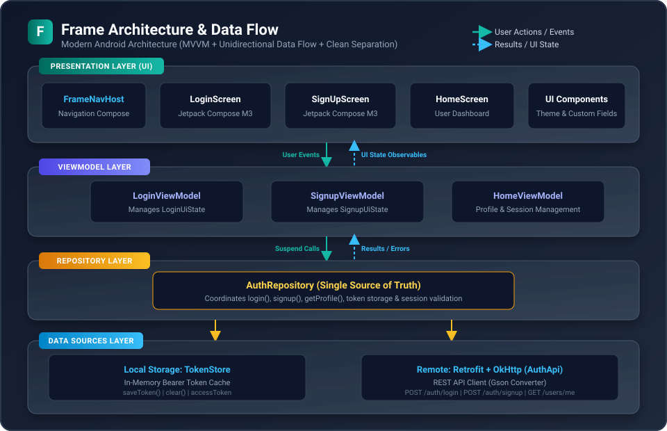

# Frame

Frame is a native Android authentication app built with Kotlin, Jetpack Compose, and Material 3. It connects to a REST API so users can create an account, sign in, view their profile, and sign out.

## Project goal

Frame provides a small, understandable foundation for Android apps that need authentication. It demonstrates how Compose screens, ViewModels, a repository, and a network client work together while keeping UI and data access separate.

The current scope is the Android client and its authentication flow. A compatible backend must be run separately; server code is not included in this repository.

## Features

- **Registration:** Create an account with a name, email, and password. Required-field and password-confirmation checks provide feedback before submission. Successful registration returns to sign-in.
- **Login:** Exchange an email and password for an access token, then open the home screen.
- **Profile:** Fetch and display the signed-in user's ID, name, and email.
- **Request feedback:** Show loading states, validation feedback, network errors, and authentication errors.
- **Logout and session handling:** Clear the token on logout or an unauthorized profile response and return to sign-in.

## Architecture

Frame uses **MVVM (Model-View-ViewModel)** with a repository in a single Android application module.



| Part | Responsibility | Source |
| --- | --- | --- |
| Screens and navigation | Render forms and profile information; navigate between login, signup, and home | [`ui/`](app/src/main/java/com/example/frame/ui) |
| ViewModels and UI state | Run requests in `viewModelScope` and expose state through Compose `mutableStateOf` | Feature packages under [`ui/`](app/src/main/java/com/example/frame/ui) |
| Repository | Coordinate requests, handle response errors, and save or clear tokens | [`AuthRepository.kt`](app/src/main/java/com/example/frame/data/repository/AuthRepository.kt) |
| Network client | Configure the base URL, declare REST endpoints, and convert JSON with Gson | [`data/remote/`](app/src/main/java/com/example/frame/data/remote) |
| Session store | Hold the current access token in memory | [`TokenStore.kt`](app/src/main/java/com/example/frame/data/local/TokenStore.kt) |

For example, signing in follows this path:

1. `LoginScreen` passes credentials to `LoginViewModel`.
2. The ViewModel calls `AuthRepository.login()` in a coroutine.
3. The repository sends a request through `ApiClient.authApi` and saves the returned access token in `TokenStore`.
4. The ViewModel updates UI state, and the screen triggers navigation to home.
5. `HomeViewModel` loads the profile through the repository using `Authorization: Bearer <token>`.

ViewModels currently construct repositories directly. The API client and token store are singleton objects; there is no separate domain/use-case layer or dependency injection framework.

## Repository layout

```text
app/src/main/
  java/com/example/frame/
    MainActivity.kt           # Activity hosting the Compose app
    data/
      local/                  # In-memory token store
      model/                  # Login, signup, and profile request/response models
      remote/                 # Retrofit client and API interface
      repository/             # Authentication and profile data access
    ui/
      components/             # Shared text and password fields
      home/                   # Profile screen, ViewModel, and state
      login/                  # Login screen, ViewModel, and state
      navigation/             # Login, signup, and home routes
      signup/                 # Signup screen, ViewModel, and state
      theme/                  # Material colors, typography, and theme
  AndroidManifest.xml
  res/                        # Android resources
app/src/test/                 # Local unit tests
app/src/androidTest/          # Device/emulator tests
docs/images/architecture.svg  # Architecture image displayed above
gradle/libs.versions.toml     # Dependency and plugin versions
```

## Technology

- Kotlin, Jetpack Compose, and Material 3
- AndroidX ViewModel, Kotlin coroutines, and Navigation Compose
- Retrofit with Gson for REST requests and JSON conversion
- Gradle Kotlin DSL with a version catalog
- Android 7.0+ (minimum SDK 24); compile and target SDK 37

Exact dependency versions are recorded in [`gradle/libs.versions.toml`](gradle/libs.versions.toml).

## Run locally

### Requirements

- Android Studio compatible with the Android Gradle Plugin version in the version catalog.
- Android SDK Platform 37 and an emulator or physical device running API 24 or higher.
- The included Gradle wrapper. The daemon JVM configuration requests **JDK 25** in [`gradle/gradle-daemon-jvm.properties`](gradle/gradle-daemon-jvm.properties).
- A running backend implementing the API contract below.

### Setup

1. Clone this repository and open its root directory in Android Studio.
2. Let Gradle sync and install required SDK components. Ensure Android Studio has configured your SDK path in `local.properties`.
3. Set the backend URL in [`ApiClient.kt`](app/src/main/java/com/example/frame/data/remote/ApiClient.kt). The checked-in URL points to a private LAN address and must be changed for your environment. Keep the trailing `/`:

   ```kotlin
   .baseUrl("http://10.0.2.2:8080/")
   ```

   On the standard Android Emulator, `10.0.2.2` reaches the development computer. For a physical device, use the computer's reachable LAN address and allow the backend port through its firewall.

4. Start the backend, select a device, and run the `app` configuration in Android Studio.

To build a debug APK from the repository root:

```powershell
# Windows PowerShell
.\gradlew.bat assembleDebug
```

```bash
# macOS / Linux
./gradlew assembleDebug
```

The APK is written to `app/build/outputs/apk/debug/app-debug.apk`.

## Backend API contract

Endpoints are declared in [`AuthApi.kt`](app/src/main/java/com/example/frame/data/remote/AuthApi.kt). Request and response field names are defined in [`data/model/`](app/src/main/java/com/example/frame/data/model).

| Method | Path | Request | Expected success |
| --- | --- | --- | --- |
| `POST` | `/auth/signup` | JSON: `name`, `email`, `password` | HTTP `201`; response model contains `id`, `name`, `email` |
| `POST` | `/auth/login` | JSON: `email`, `password` | Successful response with `id`, `name`, `email`, `accessToken`, `tokenType`, `expiresIn`; token must be nonblank |
| `GET` | `/users/me` | Header: `Authorization: Bearer <token>` | Successful response with `id`, `name`, `email` |

The client handles login `401`, signup `400`/`409`, and profile `401` with specific messages. Other failures display a general error.

## Current limitations

- Tokens live only in process memory. They are lost when the app process ends, and navigation starts at login on launch.
- There is no token refresh or expiry timer. A profile response of `401` invalidates the session; the login response's `expiresIn` is not used to schedule expiry.
- The base URL is configured in source, and the manifest allows cleartext HTTP for local development. A production deployment needs HTTPS and appropriate session storage.
- Test directories contain the default example tests; authentication flows do not yet have dedicated automated coverage.

## Contributing

Open an issue to report a bug or propose a feature. Keep UI changes in the relevant feature package and data access in the data layer. Include the behavior changed and how you verified it; never commit credentials or access tokens.
