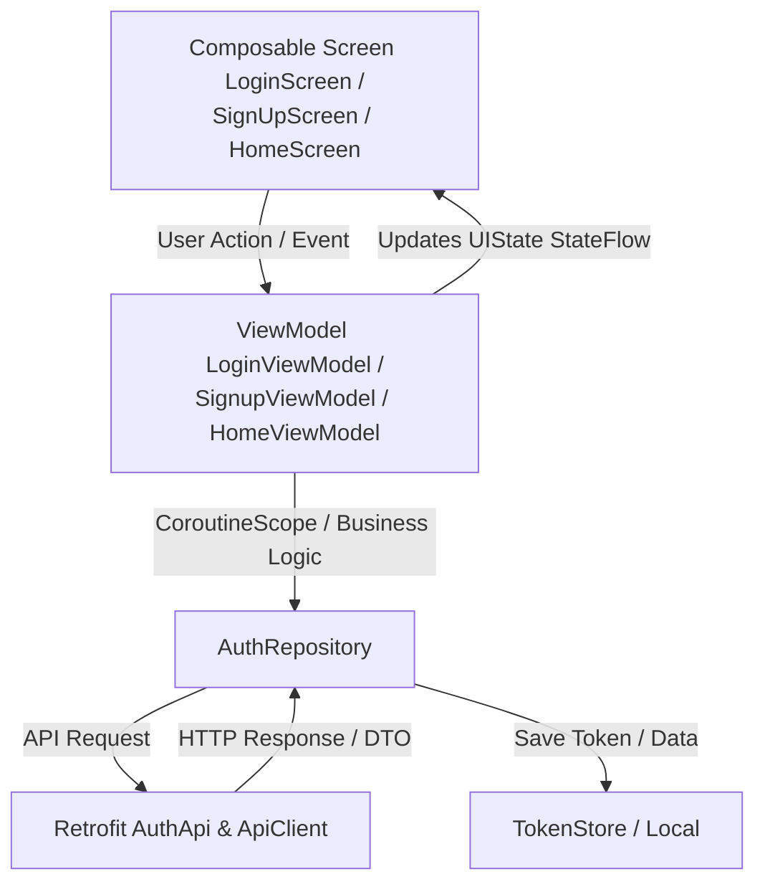

# Frame 📱

**Frame** is a modern, production-ready Android application built with **Jetpack Compose** and **Material 3**, adhering strictly to the **MVVM (Model-View-ViewModel)** architectural pattern and clean separation of concerns.

---

## 🎯 Project Goal

The primary goal of Frame is to provide a robust, scalable, and idiomatic Android boilerplate and application template demonstrating:
- **Secure Authentication Flow**: User login and registration with token-based authorization (`Bearer` tokens).
- **Session Management**: Persistent memory token store (`TokenStore`) with automatic session expiry handling and redirection.
- **Profile Management**: Fetching and displaying authenticated user profile details (`/users/me`).
- **Modern UI / UX**: Declarative UI built entirely with Jetpack Compose and Material 3 design guidelines.

---

## 🏛️ Architecture & Folder Mapping

Frame follows a clean **MVVM (Model-View-ViewModel)** architecture combined with a feature- and layer-based package structure. This ensures high testability, maintainability, and clear separation of concerns across the Data, Domain/Business Logic, and Presentation layers.

### Architecture Data Flow & Diagram



---

## 📂 Project Directory Structure

```text
com.example.frame/
├── data/
│   ├── local/
│   │   └── TokenStore.kt          # In-memory secure token management
│   ├── model/
│   │   ├── login/                 # LoginRequest, LoginResponse
│   │   ├── signup/                # SignupRequest, SignupResponse
│   │   └── user/                  # ProfileResponse
│   ├── remote/
│   │   ├── ApiClient.kt           # Retrofit client configuration
│   │   └── AuthApi.kt             # REST API endpoints (/auth/login, /auth/signup, /users/me)
│   └── repository/
│       └── AuthRepository.kt      # Single source of truth for auth & profile data operations
├── ui/
│   ├── components/
│   │   └── FrameComponents.kt     # Reusable UI components (FrameTextField, FramePasswordField)
│   ├── home/
│   │   ├── HomeScreen.kt          # Main dashboard screen
│   │   └── HomeViewModel.kt       # Profile state & session management
│   ├── login/
│   │   ├── LoginScreen.kt         # User sign-in screen
│   │   ├── LoginViewModel.kt      # Login state & authentication logic
│   │   └── LoginUiState.kt        # Login UI state holder
│   ├── navigation/
│   │   └── FrameNavHost.kt        # Jetpack Navigation Compose graph
│   ├── signup/
│   │   ├── SignUpScreen.kt        # User registration screen
│   │   ├── SignupViewModel.kt     # Signup state & registration logic
│   │   └── SignupUiState.kt       # Signup UI state holder
│   └── theme/
│       ├── Color.kt               # Custom Material 3 color palettes (Light & Dark)
│       ├── Theme.kt               # MaterialTheme wrapper
│       └── Type.kt                # Typography styles
└── MainActivity.kt                # Single Activity host
```

---

## 🧰 Tech Stack

- **UI Framework**: [Jetpack Compose](https://developer.android.com/jetpack/compose)
- **Design System**: [Material 3 (M3)](https://m3.material.io/)
- **Architecture**: MVVM (Model-View-ViewModel), StateFlow / MutableState
- **Network / HTTP Client**: [Retrofit 2](https://square.github.io/retrofit/) with Gson Converter
- **Asynchronous Operations**: Kotlin Coroutines & `viewModelScope`
- **Navigation**: Jetpack Navigation Compose (`2.10.x`)
- **Lifecycle**: Lifecycle ViewModel Compose (`2.10.x`)

---

## 🚀 Getting Started

1. Clone the repository:
   ```bash
   git clone https://github.com/Ash1ik/Frame.git
   ```
2. Open the project in **Android Studio** (Koala / Jellyfish or newer).
3. Configure your backend base URL in [ApiClient.kt](file:///D:/Frame/app/src/main/java/com/example/frame/data/remote/ApiClient.kt) if running against a local server.
4. Run the app on an Android Emulator or physical device (`app:assembleDebug`).

---

## 🤝 Contributing

Contributions, issues, and feature requests are welcome! Feel free to check the issues page or submit a pull request.
